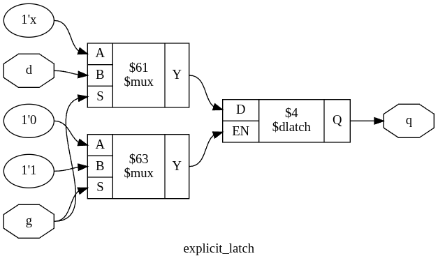
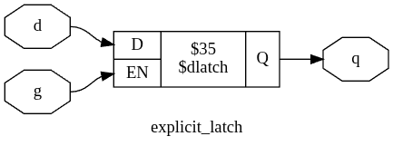

# Shared Fixes

## Default Flags

--no-implicit-memories

# Document the differences

## Top Attribute Inferred

Slang infers top, and adds a `(* top *)` attribute to modules without parents, read verilog does not do this, and `hierarchy` cannot handle that, see logs from typedef_struct_port.ys for an example:

```
2. Executing HIERARCHY pass (managing design hierarchy).
Attribute `top' found on module `top'. Setting top module to top.
Attribute `top' found on module `test_parser'. Setting top module to test_parser.
```

### Fixes

The fix is to add a `setattr -mod -unset top` before hierarchy in the script.

### Affected Tests

- typedef_struct_port.ys
- cellarray_array_connections.ys
- for_decl_shadow.ys

## Inserted Buffers

Slang seems to emit buffers when read_verilog would not. This messes up existing flows that do not expect buffers: `proc -> opt_expr`. 

### Fixes

The fix is adding `opt_clean` before `opt_expr` in the script. This can & probably should be called by read_slang instead. 

At least abstract_init.ys is affected and I've seen a few others

## Undefined Modules

While read_verilog can handle undefined modules and elaborate those later, `read_slang` required they be instantiated before elaboration. e.g. where `read_verilog` handles this `read_slang` fails

```sh
read_slang --no-proc --std latest <<EOT
module top (CLK, E, Q, Q_EN);
	input CLK;
	input E;
	output reg Q;
	output reg Q_EN;
	half_clock uut (CLK, Q, 1'b0);
	half_clock_en uut_en (CLK, E, Q_EN, 1'b0);
endmodule
EOT
opt_clean
proc
design -import half_clock
design -import half_clock_en
hierarchy -check -top top
```

### Fixes

1. Move `design -import *` before `read_slang`
2. Add a flag to `read_slang` that reads a module as a blackbox, and can instantiate it later
	3. This likely needs to be a part of a bigger refactoring to add deferred elab with slang

## Slang emits $aldff cells by default

`read_slang` seems to emit `$aldff` cells by default. A lot of tests expect dff cells, I don't know if `$aldff` are rejected by some passes, needs more searching

### Fixes

Running `opt_dff` after `opt_clean` seems to fix the issue.

## Z trit

read_slang implicitly converts `z` trits to `x` trits which have different semantics.

### Fix

I don't think this can be fixed inside yosys, this seems likely to need fixes in sv-elab or slang itself to preserve those

### Affected Tests

- opt_dff_dffmux.ys
- maybe iopadmap.ys?

## Cell port widths

Slang seems to infer that cell port widths (at least for arithmetic cells) should be the same widths for A, B, & Y, this differs from read_verilog, but I'm not sure it's a meaningful differerence?

e.g. this script fails (where read_verilog would succeed)
```sh
read_slang --no-proc <<EOT
module slang_add_test(input [3:0] i, output [4:0] o);
    assign o = i + 1'b1;
endmodule
EOT
# proc
opt_clean
write_rtlil -readable
```

and outputs the following rtlil

```
cell $add $0
  parameter \A_WIDTH 5
  parameter \B_WIDTH 5
  parameter \A_SIGNED 0
  parameter \B_SIGNED 0
  parameter \Y_WIDTH 5
  connect \A { 1'0 \i }
  connect \B 5'00001
  connect \Y $0y
end
```

### Fixes

I don't how how to fix or if it needs a fix

- the opt_expr_alu.ys seems to actually break something so this does likely need a fix

### Affected Tests

- opt_expr.ys
- opt_expr_alu.ys

## Slang infers mem cells by default

### Fixes

- add `--no-implicit-memories` to `read_slang` call
	- This should probably be the default behavior

### Affects tests

- opt_dff_eqbits.ys

## Slang flattens by default

### Fixes

- add `--keep-hierarchy` or `--best-effort-hierarchy` to `read_slang` call
	- This should probably be the default behavior

### Affects tests

- json_scopeinfo.ys
- blackbox_wb.ys
	- + also naming changes, those have to be expected though
- keep_hierarchy.ys
	- opt_clean also seems to cause this because hierarchy then prunes the modules

## read_slang doesn't add (* keep *) attributes to formal cells

### Fixes

- Should probably be done internally in the sv_elab module
- add `setattr -set keep 1 t:$check` before `chformal -lower`

### Affected Tests

- opt_merge_properties.ys

## read_slang doesn't warn about implicit latches

it should also be noted that read_slang imposes different structure on latches that `opt` didn't catch and needed special optimization passes:

read_slang:


read_verilog:


### Affected Tests

- check_nolatches.sv

## Slang doesn't preserve enum attributes

### Affected Tests

- enum_values.ys

## Slang doesn't preserve signedness

### Affected Tests

- json_netnames_signed.ys

## Slang doesn't preserve port order

### Affected tests

- port_bus_order.ys

## $initstate

This behavior should probably be fixed? 

```systemverilog
`ifdef READ_SLANG
    reg initial_state = 1'b1;

    always @(posedge clock)
        initial_state <= 1'b0;

    always @*
        assume (reset == initial_state);
`elsif YOSYS
    always @*
        assume (reset == $initstate);
`endif
```
